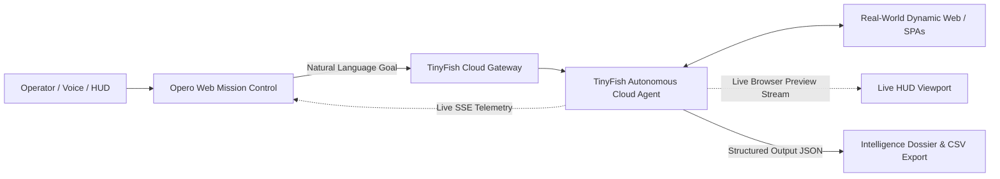

# ◈ Opero Web × TinyFish 🚀
### _Autonomous Web Execution Layer for AI Agents_

[](https://github.com/jagdeep222422/ignite-bangalore-hackathon)
[](https://agent.tinyfish.ai)
[](LICENSE)
[](#-zero-cost--free-tier-guarantee)

> **Submission for Problem Statement - 1: Best Use of the TinyFish Platform**  
> *"Instead of just generating answers, build AI agents that actually get things done on the web."*

---

## 📌 Project Overview & Team
- **Event**: Ignite With Bangalore Hackathon 2026
- **Team**:
  - [Jagdeep Kumar Mahto](https://github.com/jagdeep222422) (`@jagdeep222422`)
  - [Pavan Gowda S](https://github.com/Pavan-Gowda-S) (`@Pavan-Gowda-S`)
- **Status**: ✅ Working Prototype & Demo Ready

---

## 💡 The Problem
Traditional AI assistants stop at generating text or search snippets. When asked to complete real-world tasks (e.g. *compare live pricing across competing stores, extract executive contacts behind dynamic login/careers pages, or book registrations*), conventional bots fail due to:
1. **Dynamic Client-Side JavaScript (SPAs)**: Scrapers miss content rendered dynamically by React/Vue/Next.js.
2. **Anti-Bot & Captcha Blocking**: Cloudflare and PerimeterX block vanilla scrapers immediately.
3. **High Resource Bloat**: Running local Playwright/Puppeteer instances consumes 800MB–1.5GB of local RAM and high CPU.
4. **Brittle Selectors**: Static CSS/XPath selectors break the moment a target website updates its DOM.

---

## 🐟 The Solution: Opero Web × TinyFish
**Opero Web** leverages **TinyFish** as its cloud web execution layer. The operator describes the goal in natural language, and TinyFish autonomously navigates websites, handles stealth browser fingerprinting, clicks buttons, scrolls viewports, and extracts structured data.



---

## ✨ Key Features & Highlights

### 1. 📺 Live Browser Stream Viewport
Utilizes TinyFish's Server-Sent Events (`/v1/automation/run-sse`) to display a **real-time live stream of the agent browsing the web** directly inside the operator HUD. Judges can visually watch the agent navigate, click, and inspect DOM nodes in real time.

### 2. 🛡️ Dual-Mode Architecture (100% Free Demo Guarantee)
- **⚡ Live Cloud Mode**: Calls TinyFish live agent API with your free hackathon API key.
- **🛡️ Instant Offline Demo Mode**: Zero-cost, high-fidelity simulation engine with pre-cached real-world executions (₹0.00 spent, zero API quota risk, guaranteed reliable presentation).

### 3. 🎯 3 One-Click Hackathon Presets
1. **🛒 E-Commerce Price Arbitrage**: Navigates Amazon, Flipkart, and Croma for Apple MacBook Air M3, applies bank discount filters, and computes instant arbitrage savings (₹6,910 saved).
2. **💼 B2B Company & Tech Stack Scout**: Traverses Stripe's corporate website to find C-suite leadership and infers foundational tech stack from engineering job openings.
3. **🏆 Bangalore AI Hackathon Radar**: Scans event platforms for active AI hackathons and grants in Bangalore with prize pool tracking.

---

## 📊 Measurable Impact & Benchmarks

| Metric | Manual Human Browsing | Opero Web × TinyFish | Improvement |
| :--- | :--- | :--- | :--- |
| **Research & Extraction Time** | 18–30 minutes | 20–35 seconds | **~90% Faster** |
| **Multi-Site Workflow Automation** | 12–19 manual clicks & tabs | 1 Natural Language Prompt | **Fully Autonomous** |
| **Local System RAM Overhead** | ~1.2 GB (Local Playwright) | 0% (Cloud Execution) | **Zero Local Footprint** |
| **Total Cost** | Paid APIs or proxies | **₹0.00 (100% Free Tier)** | **Zero Financial Barrier** |

---

## 🚀 Quick Start (Running Locally)

### Prerequisites
- Node.js (v18+)

### 1. Clone & Navigate
```bash
git clone https://github.com/jagdeep222422/ignite-bangalore-hackathon.git
cd ignite-bangalore-hackathon/opero-web
```

### 2. Install & Launch
```bash
npm install
npm run dev
```

Open **[http://localhost:5173](http://localhost:5173)** in your browser!

### 3. Optional: Add Free TinyFish API Key
1. Sign up for free hackathon credits: [agent.tinyfish.ai](https://agent.tinyfish.ai/sign-up?ref=v1.dXNlcl8zSm10b3psUVhEaXI4NjZGMGdkeW1FZERodlo.eBDpjwv2_p8hsOOjeI7KLbQ2ONxk_zQnDMkV-uyWRPk)
2. Click **"Enter TinyFish Key"** in the top-right navbar to test live custom websites!

---

## 📁 Repository Structure
```
ignite-bangalore-hackathon/
├── opero-web/                  # Full-stack React + Vite Mission Control dashboard
│   ├── src/
│   │   ├── components/
│   │   │   ├── Navbar.jsx               # Header with mode switch & API key modal
│   │   │   ├── PresetSelector.jsx       # 1-click hackathon mission recipes
│   │   │   ├── MissionControls.jsx      # URL and goal parameters
│   │   │   ├── LiveBrowserViewport.jsx  # Live agent browser stream viewport
│   │   │   ├── ExecutionTelemetry.jsx   # Real-time SSE thought stream terminal
│   │   │   └── MissionResults.jsx       # Impact metrics, tables & CSV export
│   │   ├── data/mockScenarios.js        # Zero-cost demo scenarios & cached runs
│   │   ├── services/tinyfishApi.js      # TinyFish SSE client & proxy adapter
│   │   ├── App.jsx                      # Main dashboard layout
│   │   ├── App.css                      # Modern dark-mode & glassmorphism styling
│   │   └── index.css                    # Design tokens & typography
│   ├── vite.config.js                   # Vite config with TinyFish API proxy
│   └── package.json                     # Scripts & dependencies
├── README.md                            # Hackathon project documentation
├── LICENSE                              # MIT License
└── .gitignore                           # Git ignore rules
```

---

## 📄 License
This project is open-source under the [MIT License](LICENSE).
